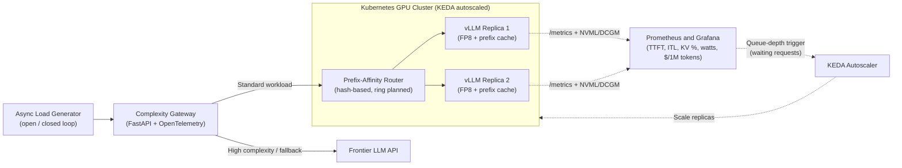

# llm-inference-systems

[](https://developer.nvidia.com/cuda-toolkit)
[](https://pytorch.org/)
[](https://github.com/vllm-project/vllm)
[](https://triton-lang.org/)
[](https://kubernetes.io/)
[](https://www.python.org/)

> **Measure, don't believe.**
> An empirical systems engineering project dissecting modern LLM inference, from GPU kernels to cluster orchestration. Being built and benchmarked on local Ada Lovelace hardware (**RTX 4060 8 GB**) plus short multi-GPU cloud sessions.

**Repository:** <https://github.com/sahanchathurangaherath/llm-inference-systems>

---

## Overview

Most AI projects treat model serving as an API call. **`llm-inference-systems`** deconstructs the inference stack step by step: measuring hardware bottlenecks, writing GPU kernels, optimizing KV-cache usage, and building routing, observability and autoscaling layers. Every claim in this repo is backed by a reproducible experiment, and results are filled in only after they are measured.

### Key Engineering Questions
1. **Compute vs. bandwidth physics:** Where do FLOPs and memory bandwidth go during prefill vs. decode, and how close do real engines get to the hardware roofline?
2. **Scheduler and batching mechanics:** Why does naive batching cause head-of-line blocking, and how does chunked prefill reshape inter-token latency (`ITL p95`) under mixed workloads?
3. **KV-cache and prefix locality:** How much `TTFT` and VRAM can FP8 KV-cache and prefix-affinity routing save?
4. **Low-bit quantization trade-offs:** How do native Ada FP8 and INT4 AWQ affect throughput, memory, perplexity and multi-step reasoning (`GSM8K`)?
5. **Distributed scaling and interconnects:** When does Tensor Parallelism hit an all-reduce ceiling compared with Pipeline Parallelism or disaggregated prefill/decode?

---

## System Architecture (Capstone Platform)



---

## Hardware and Testbed

| Parameter | Local Testbed (Stages 1-6, 8, 11-12) | Cloud Burst Testbed (Stages 7, 9, and part of 10) |
| :--- | :--- | :--- |
| **GPU** | NVIDIA RTX 4060 (Ada Lovelace, `sm_89`, native FP8) | Multi-GPU A100 / H100 nodes (rented per session) |
| **VRAM and bandwidth** | 8 GB GDDR6 (~7 GB usable), ~272 GB/s (desktop) | 80 GB HBM per GPU, NVLink / InfiniBand |
| **Runtime** | Windows 11 + WSL2 (Ubuntu 24.04), CUDA Toolkit 12.6, PyTorch `cu124` wheels | Ubuntu 22.04 LTS, NCCL, Ray, Kubernetes |
| **Models** | `Qwen2.5-0.5B / 1.5B / 3B`, one 7B AWQ model | `70B-Instruct` (TP/PP scaling) |

> Stage 10 is **hybrid**: autoscaling logic is developed on a local `kind` cluster with mock metrics, then validated in a short cloud session with a real GPU node.

---

## Engineering Modules and Progress

**Legend:** 🟢 Local GPU | 🟡 Local scaled-down | 🔴 Cloud multi-GPU

| Module | Topic | Scope and Deliverable | Stack |
| :--- | :--- | :--- | :--- |
| **[`common`](./common)** | **Benchmark harness** | Async streaming load generator (`TTFT p50/p95`, `ITL`, `tok/s`), GPU checks, cloud bootstrap scripts. | `Python`, `httpx`, `uv` |
| **[`stage-01-cuda`](./stage-01-cuda)** | **GPU foundations** 🟢 | Naive vs. 32x32 shared-memory tiled SGEMM in CUDA C++; Nsight Compute profiling against cuBLAS. | `CUDA C++`, `nvcc`, `ncu` |
| **[`stage-02-inference-physics`](./stage-02-inference-physics)** | **Inference physics** 🟢 | Analytical vs. measured KV-cache sizing, bandwidth-bound decode estimates, NVTX profiling, batch-scaling curves. | `PyTorch`, `nsys`, `NVTX` |
| **[`stage-03-serving`](./stage-03-serving)** | **Serving and batching** 🟡 | Continuous batching and PagedAttention analysis; chunked-prefill sweeps under mixed workloads. | `vLLM`, `SGLang` |
| **[`stage-04-kv-cache`](./stage-04-kv-cache)** | **KV-cache and routing** 🟡 | Two replicas sharing one GPU with FP8 KV-cache; hash-based prefix-affinity router vs. round-robin. | `FastAPI`, `vLLM` |
| **[`stage-05-quantization`](./stage-05-quantization)** | **Quantization** 🟢 | FP16 vs. native FP8 vs. INT4 AWQ: VRAM, `tok/s`, WikiText perplexity, GSM8K. | `AutoAWQ`, `FP8`, `lm-eval` |
| **[`stage-06-kernels`](./stage-06-kernels)** | **Kernel engineering** 🟢 | Fused RMSNorm and softmax in Triton; static-shape CUDA Graph capture. | `Triton`, `CUDA Graphs` |
| **[`stage-07-distributed`](./stage-07-distributed)** | **Distributed parallelism** 🔴 | Predicted vs. measured all-reduce volume; TP (`1, 2, 4`) and PP benchmarks. | `NCCL`, `Ray`, `vLLM` |
| **[`stage-08-speculative`](./stage-08-speculative)** | **Speculative decoding** 🟡 | Draft-target (`0.5B` to `1.5B`) and n-gram speculation across acceptance rate and batch size. | `vLLM`, `SGLang` |
| **[`stage-09-interconnects`](./stage-09-interconnects)** | **Interconnects and disaggregation** 🔴 | Topology mapping, intra/inter-node `nccl-tests`, disaggregated prefill/decode analysis. | `NCCL`, `RDMA`, `NVLink` |
| **[`stage-10-orchestration`](./stage-10-orchestration)** | **Cluster orchestration** 🟡🔴 | Kubernetes deployment with graceful drain and queue-depth autoscaling via KEDA (`kind` locally, short cloud validation). | `K8s`, `Helm`, `KEDA` |
| **[`stage-11-gateway`](./stage-11-gateway)** | **Gateways and telemetry** 🟢 | Complexity-based router with frontier fallback; `pynvml` Prometheus exporter; Grafana cost dashboards. | `FastAPI`, `Prometheus`, `Grafana` |
| **[`stage-12-benchmarks`](./stage-12-benchmarks)** | **Engine teardown** 🟢 | Reproducible open-loop benchmarks of `vLLM`, `SGLang`, `llama.cpp`; throughput vs. p95 ITL Pareto curves. | `vllm bench`, `matplotlib` |

---

## Key Benchmark Highlights

*Placeholders are replaced with measured numbers as each stage finishes. Nothing here is a claim until it has a result file in [`results/`](./results).*

* **CUDA shared-memory tiling (Stage 01):** Tiled SGEMM (`TILE=32`) reached **`[TBD] GFLOPS`** (`[TBD]x` over naive), or **`[TBD]%`** of cuBLAS FP32 throughput on `sm_89`.
* **Decode bandwidth utilization (Stage 02):** Batch-1 FP16 decode on `Qwen2.5-1.5B` reached **`[TBD] tok/s`**, using **`[TBD]%`** of theoretical memory bandwidth.
* **Chunked prefill (Stage 03):** Tuning `--max-num-batched-tokens` changed short-request **ITL p95 by `[TBD]%`** during long-prompt bursts.
* **Prefix-aware routing (Stage 04):** Prefix-affinity routing changed KV-cache hit rate from **`[TBD]%` to `[TBD]%`** and **TTFT p95 by `[TBD]%`**.
* **Quantization (Stage 05):** FP8 changed total VRAM by **`[TBD]%`** and GSM8K accuracy by **`[TBD]` points**; INT4 AWQ changed batch-1 decode speed by **`[TBD]x`**.
* **Triton fusion (Stage 06):** Fused RMSNorm vs. eager PyTorch: **`[TBD]x`**.

---

## Methodology

All benchmarks follow the same rules so results are comparable and reproducible:

- **Warmup:** discard the first requests/iterations before measuring.
- **Trials:** at least 3 runs per configuration; report median and spread (min/max or standard deviation).
- **Load model:** open-loop (fixed request rate) for latency/throughput curves, closed-loop (fixed concurrency) for saturation tests. Each result states which one it used.
- **Metrics:** `TTFT` (p50/p95/p99), `ITL` (mean and p95), end-to-end latency, output tokens/s, VRAM, GPU temperature, power and clocks.
- **Workloads:** short chat, long-context RAG, and shared-prefix agent traffic. Prompts, seeds and datasets are committed under each stage.
- **Controls:** one change at a time, same model and dtype across engines, no other GPU apps running, power plan set to High Performance.
- **Pinned versions:** driver, CUDA, PyTorch, vLLM, SGLang, llama.cpp and Triton versions are recorded in every result (see below).

### Per-stage README template
Each `stage-XX/README.md` contains: **Goal** → **How to reproduce** (exact commands) → **Results table** → **Plot** → **3-sentence takeaway** → **Caveats**.

---

## Pinned Versions

Fill in as you install, and commit lock files (`uv.lock` or `requirements-*.txt`). Do not use `:latest` Docker tags for published results.

| Component | Version |
| :--- | :--- |
| NVIDIA driver (Windows) | `[TBD]` |
| CUDA Toolkit | `12.6` |
| PyTorch (`cu124` wheel) | `[TBD]` |
| vLLM | `[TBD]` |
| SGLang | `[TBD]` |
| llama.cpp (commit) | `[TBD]` |
| Triton | `[TBD]` |
| Kubernetes / KEDA | `[TBD]` |

---

## Limitations

Being upfront about what these experiments can and cannot show:

- **Single small GPU:** an 8 GB RTX 4060 limits models to roughly 0.5B-3B (or a 7B AWQ). Behavior of 70B-class models is only measured in the short cloud sessions.
- **WSL2 overhead:** WSL2 can differ from native Linux (profiler support, pinned memory, GPU scheduling). Absolute numbers are WSL2 numbers.
- **Shared-GPU replicas:** Stage 04 runs two replicas on **one** GPU. Cache-hit effects are real, but absolute throughput is not representative of two independent GPUs.
- **Laptop/desktop thermals:** sustained runs can throttle; temperatures and clocks are logged with every benchmark.
- **Version drift:** vLLM, SGLang and Triton change quickly. Results are valid for the pinned versions only.
- **Cloud sessions are short:** multi-GPU results (Stages 7, 9, 10) come from brief rentals and are not long-term stability tests.

---

## Repository Layout

```text
llm-inference-systems/
├── common/                        # Shared benchmark client, hardware checks, cloud bootstrap
│   ├── bench.py                   # Async OpenAI-compatible load generator (TTFT, ITL, tok/s)
│   ├── check_gpu.py               # CUDA and architecture verification
│   ├── verify_setup.sh            # End-to-end toolchain smoke test
│   └── bootstrap_cloud.sh         # Setup for multi-GPU rental nodes
├── stage-01-cuda/                 # CUDA C++ SGEMM kernels and Nsight Compute profiles
├── stage-02-inference-physics/    # KV-cache math, roofline estimates, Nsight Systems traces
├── stage-03-serving/              # vLLM/SGLang launch scripts and chunked-prefill experiments
├── stage-04-kv-cache/             # Prefix-affinity FastAPI router and multi-replica benchmarks
├── stage-05-quantization/         # FP16 / FP8 / INT4-AWQ evaluation scripts and tables
├── stage-06-kernels/              # Triton fused kernels and CUDA Graph benchmarks
├── stage-07-distributed/          # TP/PP benchmarks and NCCL logs
├── stage-08-speculative/          # Draft-model and n-gram speculative decoding sweeps
├── stage-09-interconnects/        # Topology maps and disaggregated serving analysis
├── stage-10-orchestration/        # Kubernetes manifests, Helm values, KEDA ScaledObjects
├── stage-11-gateway/              # Complexity router, pynvml exporter, Grafana dashboards
├── stage-12-benchmarks/           # Cross-engine Pareto scripts and raw CSV data
├── results/                       # Plots, latency tables, raw JSON/CSV outputs (small files only)
├── ROADMAP.md                     # Detailed 12-stage execution guide and troubleshooting
├── LICENSE
└── README.md
```

> **Large artifacts:** do not commit `.nsys-rep`, `.ncu-rep`, model weights or large traces. Attach them to GitHub Releases (or use Git LFS) and commit only small CSV/JSON summaries.

---

## Quick Start and Reproducibility

### 1. Clone and verify the toolchain
```bash
git clone https://github.com/sahanchathurangaherath/llm-inference-systems.git
cd llm-inference-systems
bash common/verify_setup.sh
```

### 2. Create isolated Python environments (`uv`)
Serving and quantization tools pin conflicting PyTorch/CUDA versions, so each gets its own environment.
```bash
# Core: CUDA, PyTorch, Triton, profiling helpers (Stages 1, 2, 6)
uv venv .venv-core --python 3.11 && source .venv-core/bin/activate
uv pip install torch torchvision --index-url https://download.pytorch.org/whl/cu124
uv pip install transformers accelerate datasets triton numpy pandas matplotlib httpx nvidia-ml-py
deactivate

# vLLM + gateway + evaluation (Stages 3, 4, 5, 7, 8, 11, 12)
uv venv .venv-vllm --python 3.11 && source .venv-vllm/bin/activate
uv pip install vllm httpx fastapi uvicorn prometheus-client nvidia-ml-py "lm-eval[vllm]" matplotlib pandas
deactivate

# Quantization tooling (Stage 5): kept separate because it can pin older torch
uv venv .venv-quant --python 3.11 && source .venv-quant/bin/activate
uv pip install torch --index-url https://download.pytorch.org/whl/cu124
uv pip install transformers accelerate autoawq lm-eval
deactivate

# SGLang (Stages 3, 8, 12)
uv venv .venv-sglang --python 3.11 && source .venv-sglang/bin/activate
uv pip install "sglang[all]"
deactivate
```

### 3. Build llama.cpp with CUDA (Stage 12)
```bash
git clone https://github.com/ggml-org/llama.cpp && cd llama.cpp
cmake -B build -DGGML_CUDA=ON
cmake --build build --config Release -j
./build/bin/llama-server -m <model.gguf> --port 8080 -ngl 99
```

### 4. Smoke test and benchmark client
```bash
# Terminal 1: vLLM server sized for 8 GB VRAM
source .venv-vllm/bin/activate
vllm serve Qwen/Qwen2.5-1.5B-Instruct --max-model-len 4096 --gpu-memory-utilization 0.80

# Terminal 2: async streaming benchmark
source .venv-vllm/bin/activate
python common/bench.py
```

> Flags and metric names change between engine versions. If a command fails, check `--help` for your pinned version.

---

## References

- Kwon et al., *Efficient Memory Management for Large Language Model Serving with PagedAttention* (SOSP 2023)
- Dao et al., *FlashAttention: Fast and Memory-Efficient Exact Attention with IO-Awareness* (2022)
- Williams, Waterman, Patterson, *Roofline: An Insightful Visual Performance Model for Multicore Architectures* (2009)
- Lin et al., *AWQ: Activation-aware Weight Quantization for LLM Compression and Acceleration* (2023)
- Agrawal et al., *Taming Throughput-Latency Tradeoff in LLM Inference with Sarathi-Serve* (OSDI 2024)
- Leviathan et al., *Fast Inference from Transformers via Speculative Decoding* (ICML 2023)

---

## License

Choose a license and add a `LICENSE` file (MIT or Apache-2.0 are common for projects like this).

---

## Author

**Sahan**
- **GitHub:** [@sahanchathurangaherath](https://github.com/sahanchathurangaherath)
- **Repository:** [llm-inference-systems](https://github.com/sahanchathurangaherath/llm-inference-systems)